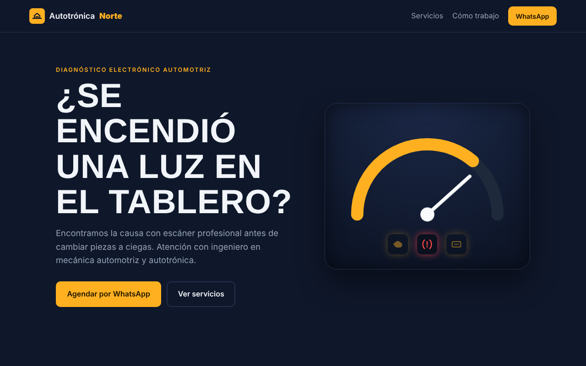

# Autotrónica Norte

Landing page for my automotive electronic diagnostics service: OBD2 code reading, TPMS sensor programming
and DPF regeneration, with booking through WhatsApp.

## Tech

Single-page HTML + CSS, no framework or build step. Animated dashboard gauge and warning lights drawn in SVG/CSS,
responsive, *reduced-motion* friendly.

## Run it

Open `index.html` or serve the folder (`npx serve .`).

## 2026 rebuild

The 2022 version had three pages with "Lorem ipsum" placeholder text, the full Bootstrap and Hover.css source
trees committed (~300 files), Windows-style `\` paths that break on Linux hosting, and stock photos downloaded
from the web. It's now one page with original SVG artwork and real content. Fixed 2022 prices were replaced
with "quote by WhatsApp". The original version is in the git history.
